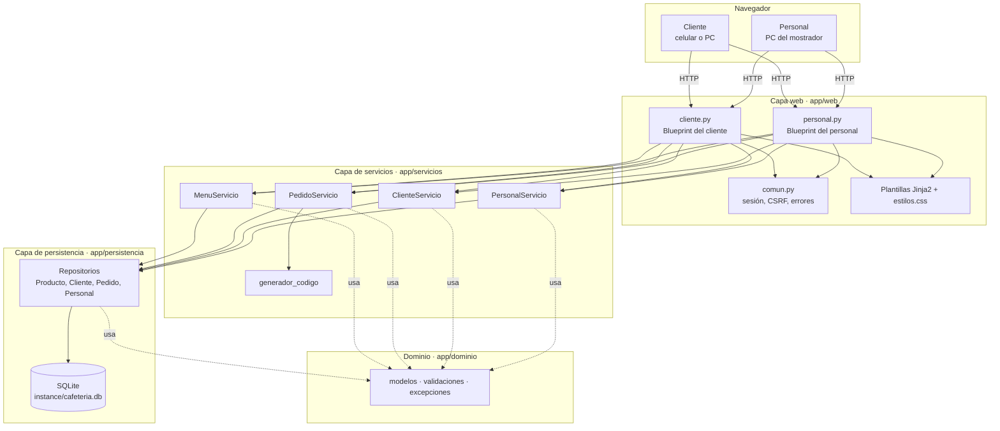
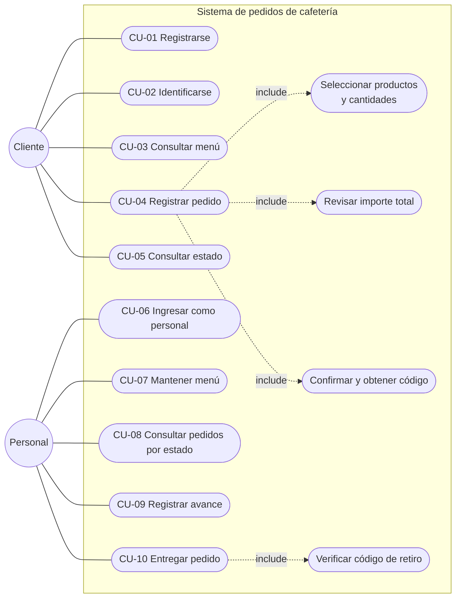
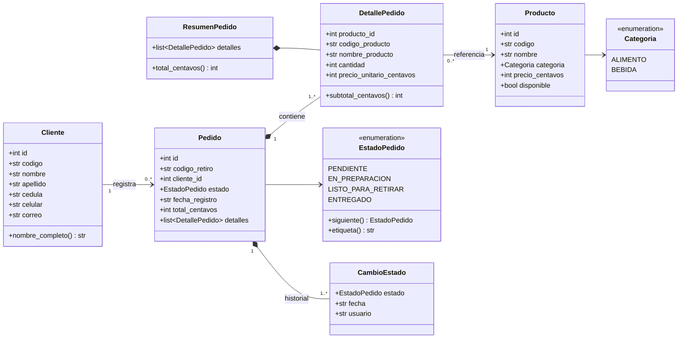
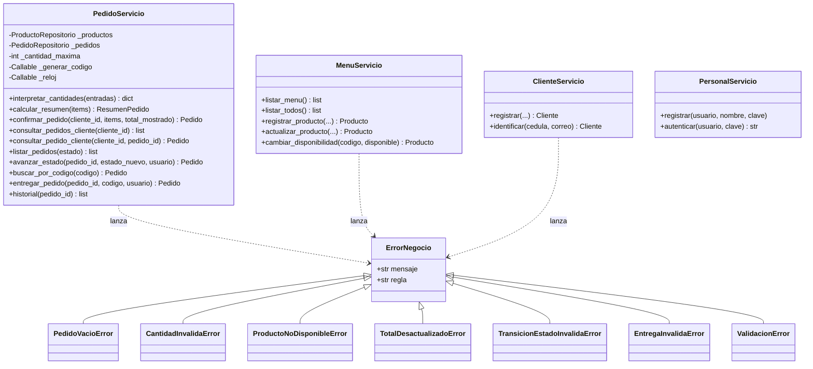
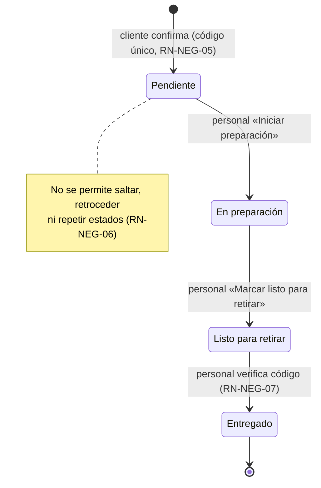
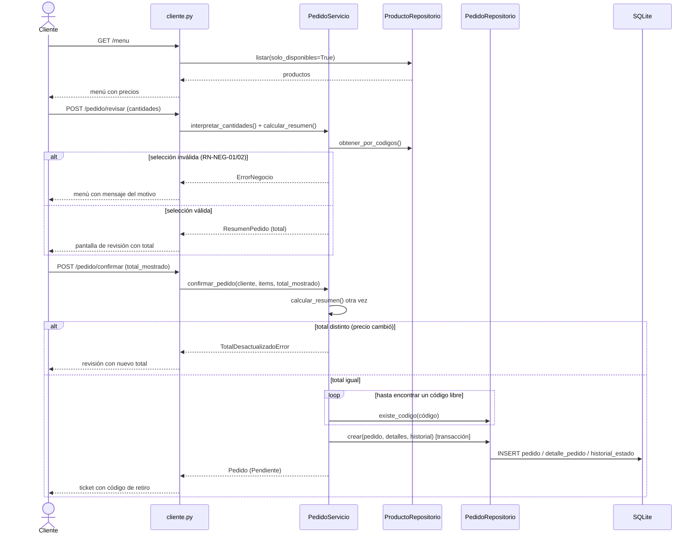
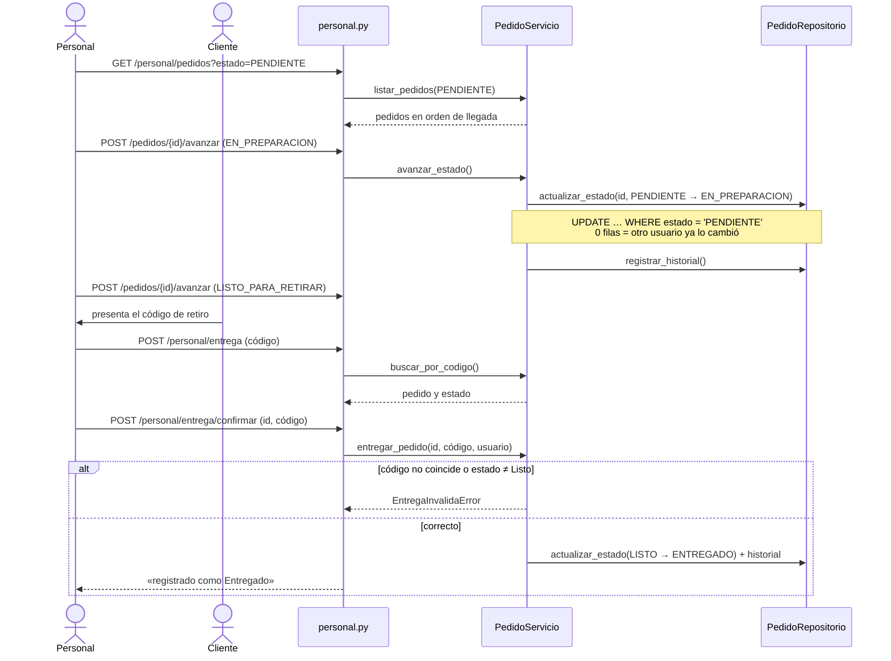
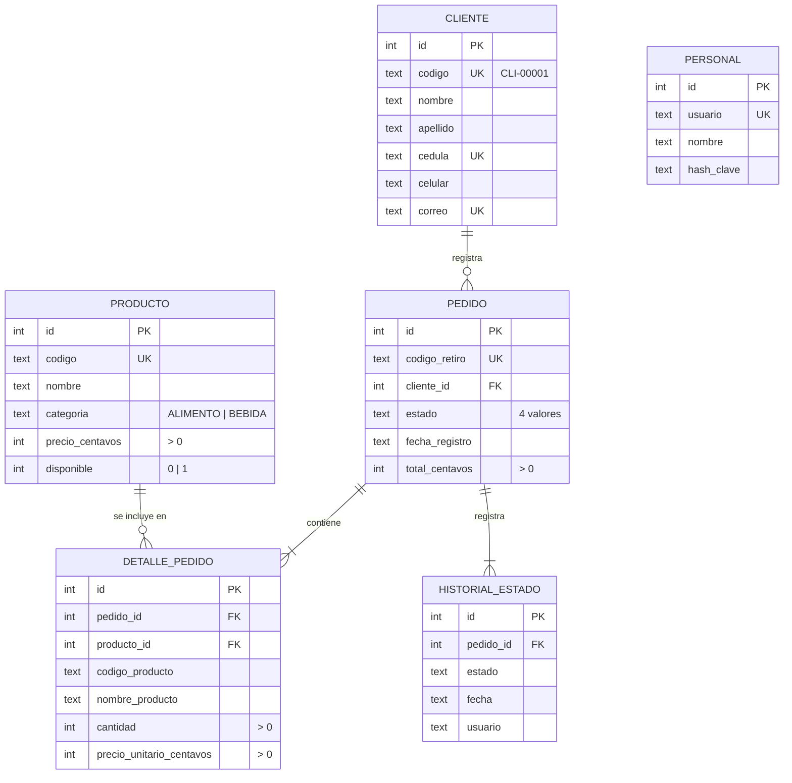
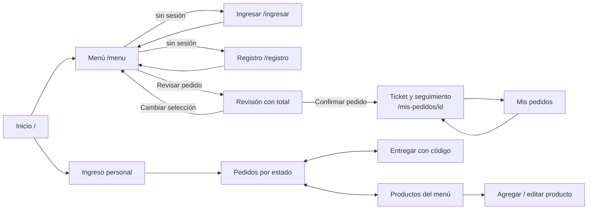

# 2. Documentación de Diseño

## 2.1 Visión general de la arquitectura

La aplicación es una aplicación web monolítica organizada en **cuatro capas**. Cada capa solo depende de las capas inferiores, lo que permite probar las reglas de negocio sin servidor web ni navegador.

| Capa | Responsabilidad | No debe |
|---|---|---|
| Web | Recibir peticiones, leer formularios, controlar sesión y CSRF, elegir la plantilla y los mensajes. | Contener reglas de negocio ni SQL. |
| Servicios | Ejecutar los casos de uso y aplicar las reglas RN-NEG-01 a 07; controlar transacciones. | Conocer HTTP ni HTML. |
| Persistencia | Leer y escribir filas y convertirlas en entidades. | Decidir si una operación es válida. |
| Dominio | Entidades, enumeraciones de estado, validaciones de datos y excepciones de negocio. | Depender de otras capas. |

## 2.2 Decisiones de diseño

| # | Decisión | Alternativas consideradas | Motivo |
|---|---|---|---|
| D-01 | Python 3.11+ con Flask | Java/Spring Boot, Node/Express | Ligero, sin servidor de aplicaciones; facilita la instalación en los equipos del equipo y del docente. |
| D-02 | SQLite en archivo | MySQL, PostgreSQL | Cumple la persistencia sin instalar un motor; suficiente para una cafetería. El acceso pasa por repositorios, así que cambiar de motor solo afecta a esa capa. |
| D-03 | SQL con `sqlite3` estándar, sin ORM | SQLAlchemy | Menos dependencias y SQL visible para el análisis del curso. |
| D-04 | Importes en centavos enteros | `float`, `Decimal` en BD | Exactitud en sumas (RN-NEG-03). |
| D-05 | Precio unitario copiado en `detalle_pedido` | Calcular desde `producto` | Cumple RN-NEG-04 de forma estructural. |
| D-06 | Estados como `Enum` con orden implícito y método `siguiente()` | Tabla de transiciones | Un solo lugar define el orden de RN-NEG-06. |
| D-07 | Entrega mediante búsqueda por código | Botón «Entregar» en la lista | Obliga a verificar el código (RN-NEG-07, RN-04). |
| D-08 | Control de concurrencia optimista (`UPDATE … WHERE estado = ?`) | Bloqueos | Evita dobles avances con dos empleados o doble clic, sin bloquear. |
| D-09 | Inyección del generador de código y del reloj en `PedidoServicio` | Llamadas directas | Permite probar colisiones de código y fechas exactas. |
| D-10 | Renderizado en servidor con Jinja2, sin JavaScript obligatorio | SPA con React | Menor complejidad; funciona en cualquier navegador; actualización automática por `meta refresh`. |

## 2.3 Diagrama de casos de uso

## 2.4 Modelo de dominio (diagrama de clases)

### Clases de servicio

Las excepciones guardan la regla de negocio que las origina (atributo `regla`), lo que facilita la trazabilidad entre el código, los requisitos y las pruebas.

## 2.5 Ciclo de vida del pedido (diagrama de estados)

## 2.6 Diagramas de secuencia

### PN-01 · Registro de un pedido

### PN-02 · Preparación y entrega

## 2.7 Modelo de datos

### Diccionario de datos (restricciones relevantes)

| Tabla.columna | Restricción | Regla que protege |
|---|---|---|
| `pedido.codigo_retiro` | `NOT NULL UNIQUE` | RN-NEG-05 |
| `pedido.estado` | `CHECK (estado IN (…4 valores…))` | RN-NEG-06 |
| `pedido.total_centavos` | `CHECK (> 0)` | RN-NEG-01 |
| `detalle_pedido.cantidad` | `CHECK (> 0)` | RN-NEG-01 |
| `detalle_pedido.precio_unitario_centavos` | copia del precio al confirmar | RN-NEG-04 |
| `detalle_pedido (pedido_id, producto_id)` | `UNIQUE` | un producto aparece una vez por pedido |
| `producto.precio_centavos` | `CHECK (> 0)` | precios válidos |
| `cliente.cedula`, `cliente.correo` | `UNIQUE` | sin clientes duplicados |
| Índices `idx_pedido_estado`, `idx_pedido_cliente` | — | RNF-07 rendimiento |

`detalle_pedido` guarda también código y nombre del producto: el pedido histórico se muestra igual aunque el producto se renombre después.

## 2.8 Diseño de la interfaz

### Mapa de navegación

### Rutas

| Método | Ruta | Acceso | Descripción | HU |
|---|---|---|---|---|
| GET | `/` | público | Inicio con acceso para cliente y personal | — |
| GET, POST | `/registro` | público | Registro de cliente | HU-01 |
| GET, POST | `/ingresar` | público | Identificación del cliente | HU-02 |
| POST | `/salir` | cliente | Cerrar sesión | — |
| GET | `/menu` | público | Menú con precios; cantidades si hay sesión | HU-03, HU-04 |
| POST | `/pedido/revisar` | cliente | Valida selección y muestra total | HU-04, HU-05 |
| POST | `/pedido/confirmar` | cliente | Registra pedido y genera código | HU-06 |
| GET | `/mis-pedidos` | cliente | Pedidos del cliente | HU-07 |
| GET | `/mis-pedidos/<id>` | cliente dueño | Ticket, seguimiento y detalle | HU-06, HU-07 |
| GET, POST | `/personal/ingresar` | público | Ingreso del personal | HU-10 |
| GET | `/personal/pedidos?estado=` | personal | Pedidos por estado | HU-11 |
| POST | `/personal/pedidos/<id>/avanzar` | personal | Avance de estado | HU-12 |
| GET, POST | `/personal/entrega` | personal | Búsqueda por código | HU-13 |
| POST | `/personal/entrega/confirmar` | personal | Registro de entrega | HU-13 |
| GET | `/personal/productos` | personal | Listado del menú | HU-08, HU-09 |
| GET, POST | `/personal/productos/nuevo` | personal | Alta de producto | HU-08 |
| GET, POST | `/personal/productos/<codigo>/editar` | personal | Edición | HU-09 |
| POST | `/personal/productos/<codigo>/disponibilidad` | personal | Activar/desactivar | HU-09 |

### Lineamientos visuales

El menú se presenta como la **pizarra** de la cafetería (fondo verde pizarra, líneas punteadas entre nombre y precio), un referente que el cliente ya conoce del mostrador. El código de retiro se presenta como un **ticket** con letras grandes en fuente monoespaciada para leerlo fácilmente en voz alta. Cada estado tiene un color fijo (azul Pendiente, ámbar En preparación, verde Listo para retirar, gris Entregado) que se repite en todas las pantallas. Los estilos están en un único archivo (`app/web/static/estilos.css`), se adaptan a celulares y respetan el modo oscuro del sistema y la preferencia de movimiento reducido.

## 2.9 Diseño de seguridad

| Amenaza | Medida |
|---|---|
| Robo de claves del personal | Hash con sal (`werkzeug.security`, scrypt); nunca se guarda la clave en texto. |
| Falsificación de solicitudes (CSRF) | Token aleatorio por sesión en todo formulario `POST`; se rechaza si falta o no coincide. |
| Inyección SQL | Todas las consultas son parametrizadas; la consulta por lista de códigos usa `json_each(?)` en lugar de construir SQL. |
| Acceso a pedidos ajenos | `consultar_pedido_cliente` compara el dueño del pedido con el cliente de la sesión. |
| Redirección abierta | `ruta_local` solo acepta rutas internas (`/…`, no `//…`). |
| Adivinar códigos de retiro | 31⁶ ≈ 887 millones de combinaciones generadas con `secrets`. |
| Manipulación de cookies | Sesión firmada con clave secreta aleatoria persistida en `instance/secret_key`; cookies `HttpOnly` y `SameSite=Lax`. |

## 2.10 Manejo de errores

Las violaciones de reglas se modelan como subclases de `ErrorNegocio`. Las rutas las capturan y muestran el mensaje en la misma pantalla (código HTTP 422 en validaciones, 409 si el total cambió, 401 en credenciales). Los errores no capturados de tipo `ErrorNegocio` se muestran en la página de error con código 400. Los errores HTTP 404 y 405 tienen páginas propias en español. Toda operación que escribe varias filas (pedido, detalles e historial) se ejecuta en una transacción: si algo falla no queda un pedido incompleto.
