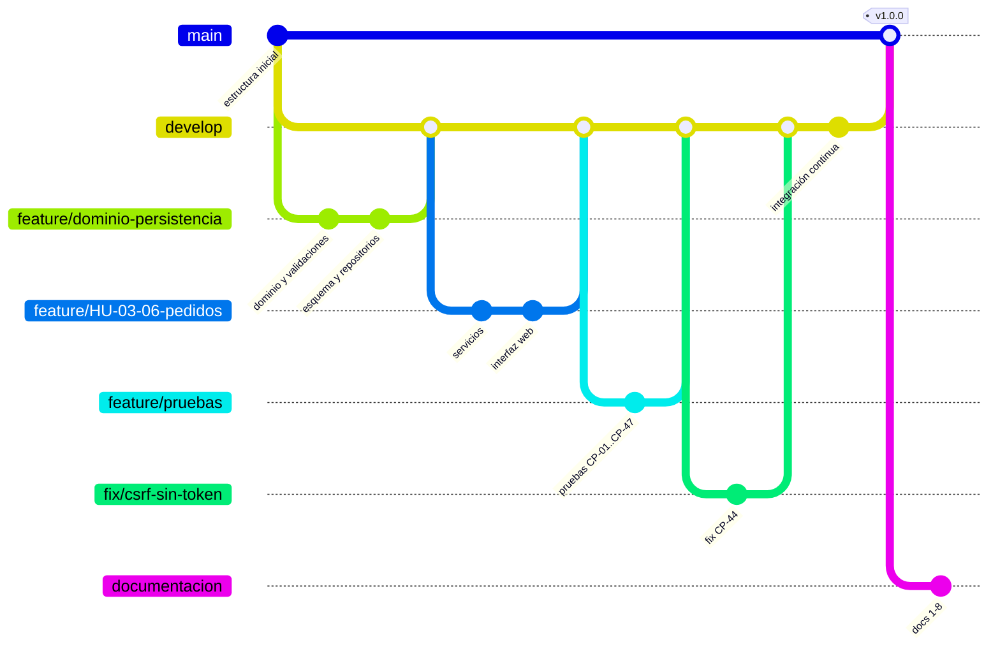

# 3. Documentación del Ambiente de Desarrollo

## 3.1 Herramientas seleccionadas

| Propósito | Herramienta | Versión | Motivo de la elección |
|---|---|---|---|
| Lenguaje | Python | 3.11 o superior (probado en 3.12.3) | Sintaxis clara, biblioteca estándar con SQLite incluido. |
| Framework web | Flask | 3.1.3 | Microframework con blueprints, plantillas Jinja2 y cliente de pruebas integrado. |
| Base de datos | SQLite (módulo `sqlite3`) | 3.45 (incluida en Python) | Persistencia en archivo sin instalar un servidor. |
| Editor / IDE | Visual Studio Code + extensiones *Python*, *Pylint*, *Flake8*, *Markdown Preview Mermaid Support* | — | Gratuito, multiplataforma, integra análisis y depuración. |
| Control de versiones | Git + GitHub | Git ≥ 2.40 | Requerido por la cátedra; revisiones mediante *pull requests*. |
| Integración continua | GitHub Actions (`.github/workflows/ci.yml`) | — | Ejecuta pruebas y análisis en cada *push* y *pull request*. |
| Pruebas | pytest | 9.2.0 | Fixtures, parametrización y reportes JUnit. |
| Cobertura | pytest-cov (coverage.py) | 7.1.0 | Cobertura de líneas y ramas, reporte HTML. |
| Análisis estático | pylint · flake8 · bandit · radon | 4.1.3 · 7.5.0 · 1.9.4 · 6.0.1 | Estilo y errores; PEP 8; seguridad; complejidad y mantenibilidad. |
| Documentación técnica | pdoc | 16.0.0 | Genera HTML a partir de los *docstrings* (equivalente a JavaDoc). |
| Pruebas de sistema y capturas | Playwright (Chromium) | 1.56.0 | Recorre la aplicación en un navegador real y genera las capturas del manual. |
| Diagramas | Mermaid (en Markdown) | — | GitHub los dibuja directamente; quedan versionados como texto. |

Las dependencias están fijadas en `requirements.txt` (ejecución) y `requirements-dev.txt` (desarrollo).

## 3.2 Estructura del repositorio

```text
cafeteria-pedidos/
├── app/
│   ├── __init__.py            # create_app(): arranque y configuración
│   ├── config.py              # variables de entorno
│   ├── datos_demo.py          # menú de ejemplo
│   ├── dominio/               # modelos, validaciones, excepciones
│   ├── persistencia/          # esquema SQLite y repositorios
│   ├── servicios/             # casos de uso y reglas de negocio
│   └── web/                   # blueprints, plantillas y estilos
├── tests/                     # pruebas pytest (CP-01 a CP-47)
├── scripts/capturas.py        # prueba de sistema con navegador y capturas
├── docs/                      # solo en la rama documentacion
├── .github/workflows/ci.yml   # integración continua
├── run.py                     # punto de entrada
├── requirements.txt / requirements-dev.txt
├── pyproject.toml / .flake8   # configuración de herramientas
└── README.md
```

## 3.3 Estrategia de ramificación

Se usa **GitFlow simplificado**, más la rama `documentacion` exigida para la entrega.

| Rama | Vida | Se crea desde | Se integra en | Contenido |
|---|---|---|---|---|
| `main` | permanente | — | — | Solo versiones estables y etiquetadas (`v1.0.0`). Protegida: nadie hace *push* directo. |
| `develop` | permanente | `main` | `main` (al liberar) | Integración de funcionalidades terminadas. |
| `feature/HU-xx-descripcion` | temporal | `develop` | `develop` | Una historia de usuario o tarea. |
| `fix/descripcion` | temporal | `develop` | `develop` | Corrección de un defecto encontrado en pruebas. |
| `hotfix/descripcion` | temporal | `main` | `main` y `develop` | Corrección urgente de una versión liberada. |
| `documentacion` | permanente | `main` | — | Código estable + carpeta `docs/` con los 8 entregables. |



### Reglas del flujo

1. **Nombres de rama** en minúsculas con guiones e ID de historia: `feature/HU-13-entrega-con-codigo`.
2. **Mensajes de commit** con la convención *Conventional Commits* en español: `feat(pedidos): genera código de retiro único`, `fix(web): …`, `test: …`, `docs: …`, `refactor: …`, `chore: …`. Un commit = un cambio coherente.
3. **Pull request obligatorio** hacia `develop` y `main`, con al menos **una revisión aprobada** de otro integrante y la integración continua en verde.
4. **Integración con `--no-ff`** para conservar la historia de cada rama.
5. **Versionado semántico**: `vMAYOR.MENOR.PARCHE`; el Release 1.0 es `v1.0.0`.
6. **Protección de `main`** en GitHub (*Settings → Branches → Branch protection rules*): exigir PR, revisión y CI aprobada.

## 3.4 Flujo de trabajo diario

```bash
git switch develop && git pull                     # 1. partir de develop actualizado
git switch -c feature/HU-07-estado-pedido          # 2. rama para la historia
# … programar + pruebas …
pytest && flake8 app tests && pylint app           # 3. verificar localmente
git add -A && git commit -m "feat(pedidos): consulta de estado por el cliente"
git push -u origin feature/HU-07-estado-pedido     # 4. publicar
# 5. abrir el pull request hacia develop en GitHub, pedir revisión, esperar CI
# 6. tras aprobar: "Merge pull request" (sin fast-forward) y borrar la rama
```

Para liberar: PR de `develop` a `main`, integrar, etiquetar (`git tag -a v1.0.0 -m "Release 1.0"`, `git push --tags`) y actualizar `documentacion` desde `main` (`git switch documentacion && git merge main`).

## 3.5 Definición de terminado

Una historia está terminada cuando: cumple todos sus criterios de aceptación; tiene pruebas automatizadas que los cubren y pasan; pylint ≥ 9.0, flake8 sin avisos y bandit sin hallazgos de severidad media o alta; las funciones públicas tienen *docstring*; fue revisada en un *pull request*; y el manual de usuario refleja cualquier cambio visible.

## 3.6 Preparación del entorno

```bash
git clone https://github.com/fernand0-carrera/cafeteria-pedidos.git
cd cafeteria-pedidos
python -m venv .venv
# Windows: .venv\Scripts\activate      Linux/macOS: source .venv/bin/activate
pip install -r requirements-dev.txt
python -m playwright install chromium     # solo para scripts/capturas.py
```

### Comandos de calidad

| Tarea | Comando |
|---|---|
| Ejecutar la aplicación | `python run.py` |
| Pruebas | `pytest` |
| Pruebas con cobertura | `pytest --cov=app --cov-branch --cov-report=html` |
| Estilo PEP 8 | `flake8 app tests scripts run.py` |
| Análisis completo | `pylint app run.py scripts` y `pylint tests` |
| Seguridad | `bandit -r app run.py` |
| Complejidad | `radon cc app -s -a` · `radon mi app -s` |
| Documentación técnica | `pdoc app -o docs/api --docformat google` |
| Prueba de sistema y capturas | `python scripts/capturas.py docs/img` |

## 3.7 Integración continua

`.github/workflows/ci.yml` se ejecuta en cada *push* a `main`, `develop` y `documentacion` y en cada *pull request*. Instala Python 3.11 y 3.12, y ejecuta flake8, pylint (falla bajo 9.0), bandit y pytest con cobertura (falla bajo 85 %). El reporte de cobertura queda como artefacto descargable del flujo.
