# 8. Manual de Usuario

Sistema de pedidos de la cafetería universitaria · Release 1.0

Este manual tiene dos partes: una para **clientes** (estudiantes y docentes) y otra para el **personal de cafetería**. Cada parte sigue el orden en que se usa el sistema en el día a día.

## 8.1 Antes de empezar

Abra en su navegador (en el celular o en un computador) la dirección que le indique la cafetería, por ejemplo `http://192.168.1.20:5000`. La página de inicio tiene dos accesos: uno para clientes y otro para el personal.

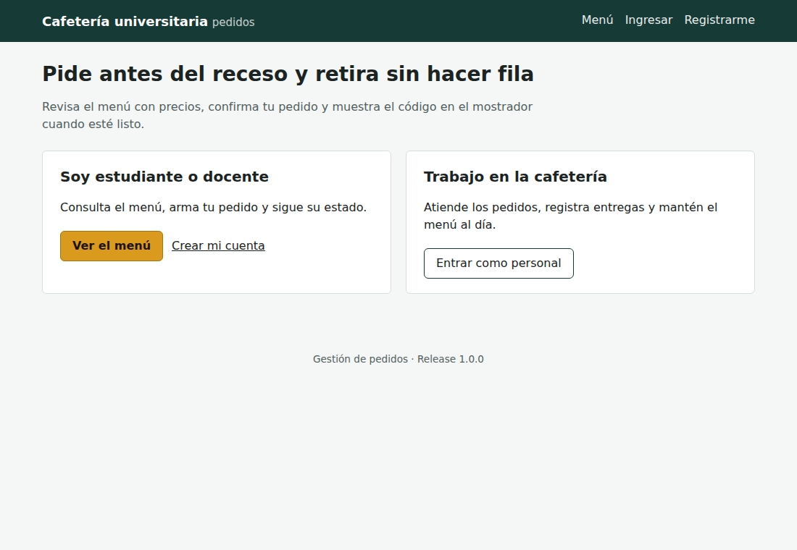

---

## Parte A · Clientes

### A.1 Crear su cuenta (solo la primera vez)

1. Pulse **Registrarme** en la barra superior.
2. Escriba nombre, apellido, cédula (10 dígitos, sin guion), celular (10 dígitos, empieza con 09) y su **correo institucional**.
3. Pulse **Crear mi cuenta**.

El sistema le asigna un código de cliente (por ejemplo `CLI-00001`), que verá junto a su nombre en la barra superior, y lo lleva al menú.

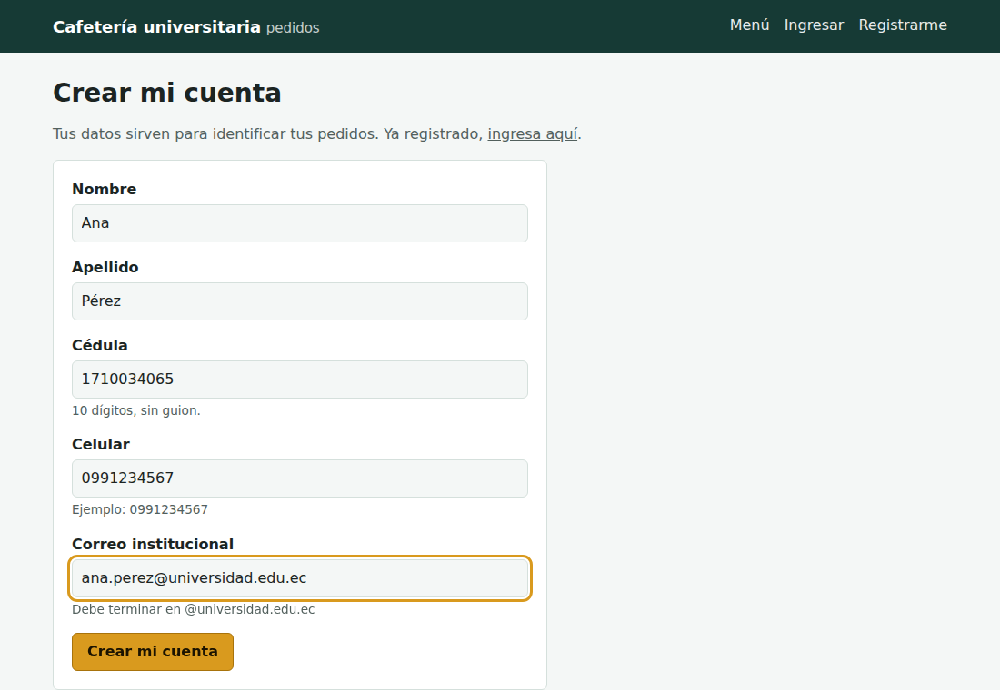

Si algún dato no es válido, aparece un mensaje en rojo que indica qué corregir; los datos ya escritos se conservan.

### A.2 Ingresar en otra ocasión

Pulse **Ingresar** y escriba la cédula y el correo con los que se registró.

### A.3 Consultar el menú y elegir productos

1. Pulse **Menú**. Verá los productos disponibles, agrupados en «Para comer» y «Para tomar», con su precio.
2. En la casilla a la derecha de cada producto escriba **cuántas unidades** quiere. Deje vacíos los que no quiera.
3. Pulse **Revisar pedido**.

Puede consultar el menú sin ingresar; para pedir debe ingresar o registrarse.

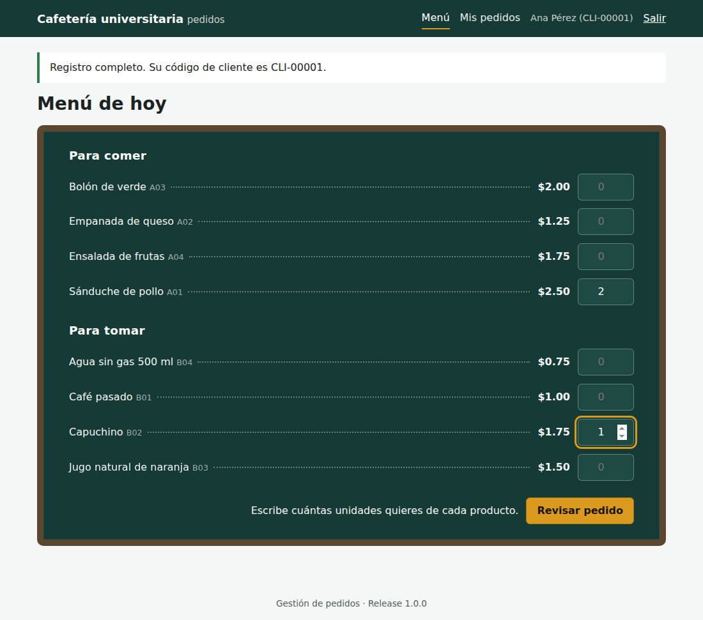

### A.4 Revisar el total y confirmar

La pantalla de revisión muestra cada producto con su cantidad, precio, subtotal y el **total a pagar**. El pago se hace en el mostrador al retirar.

- Para cambiar algo, pulse **Cambiar selección**: vuelve al menú con sus cantidades.
- Si todo está bien, pulse **Confirmar pedido**.

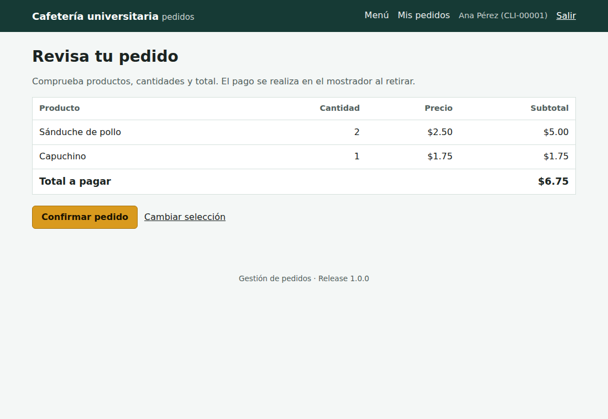

### A.5 Su código de retiro

Al confirmar verá un ticket con el **código de retiro** de 6 caracteres. Ese código es lo que mostrará en el mostrador; consérvelo (puede volver a verlo en «Mis pedidos»).

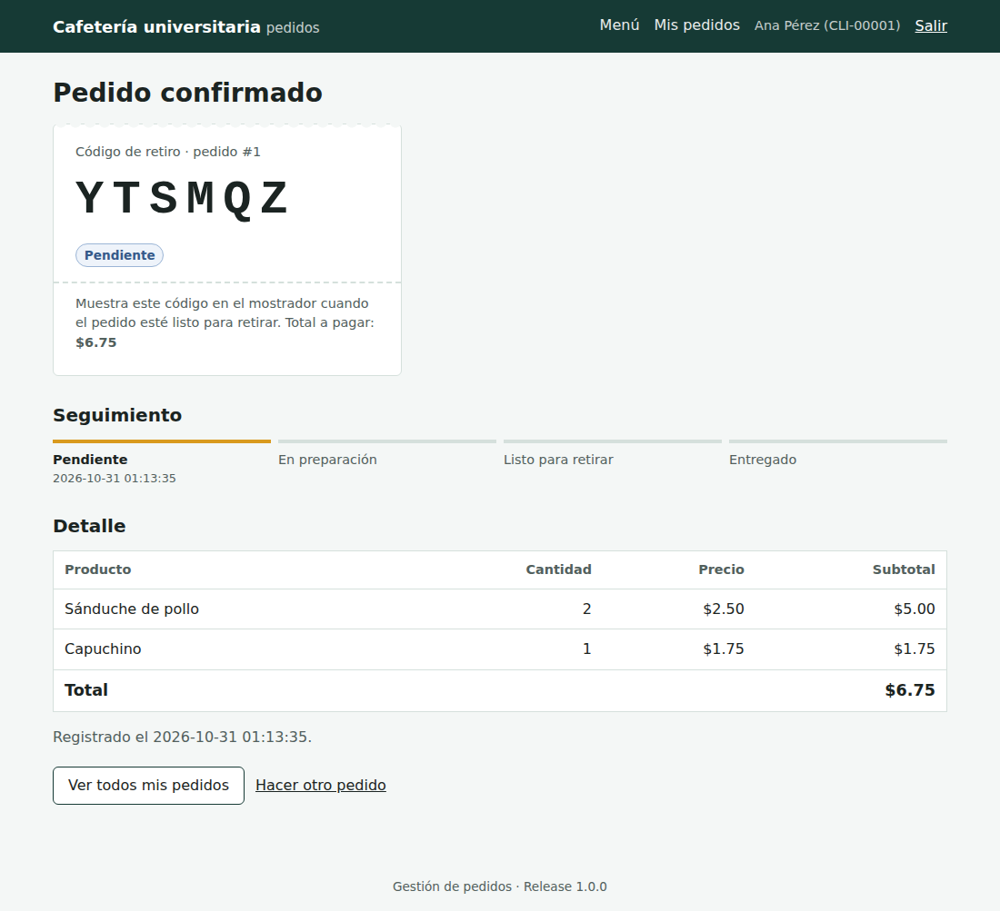

Debajo del ticket está el **seguimiento** del pedido con la hora en que alcanzó cada estado:

| Estado | Qué significa para usted |
|---|---|
| **Pendiente** | La cafetería recibió su pedido y aún no empieza a prepararlo. |
| **En preparación** | Su pedido se está preparando. |
| **Listo para retirar** | Acérquese al mostrador con su código. |
| **Entregado** | Ya retiró su pedido. |

### A.6 Consultar el estado de sus pedidos

Pulse **Mis pedidos** para ver todos sus pedidos, del más reciente al más antiguo, con su código, estado y total. La página se actualiza sola cada 30 segundos. Pulse el número de un pedido para ver su detalle.

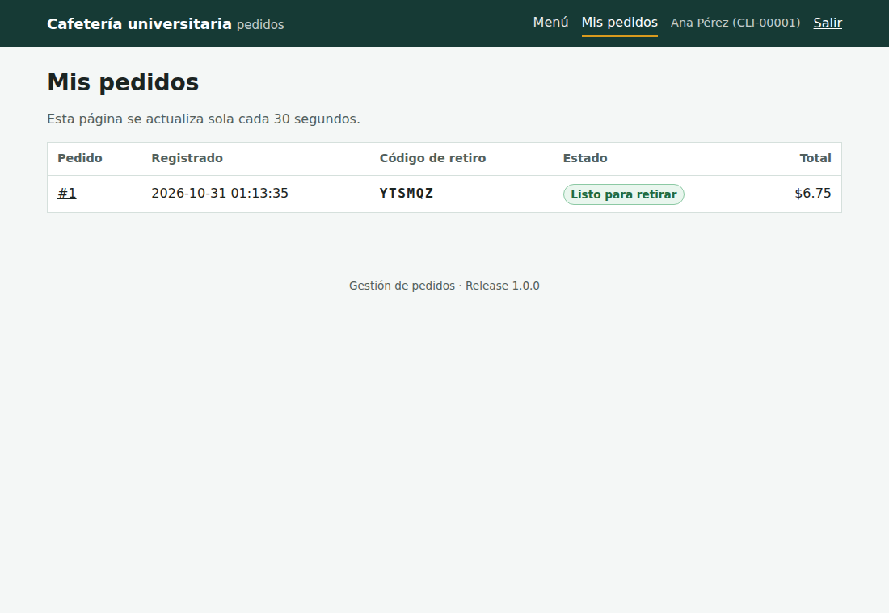

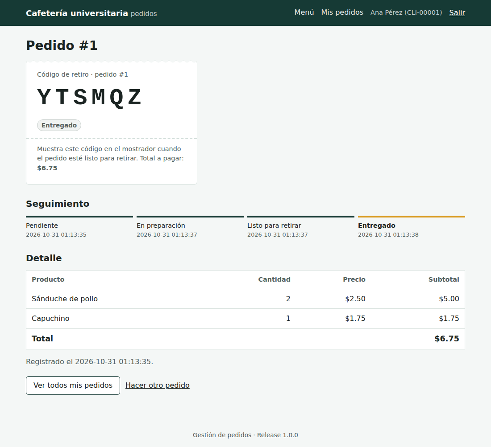

### A.7 Retirar el pedido

Cuando el estado sea **Listo para retirar**, vaya al mostrador, muestre o dicte su código y pague. El personal solo puede entregarle el pedido si el código coincide.

### A.8 Mensajes que puede ver

| Mensaje | Qué hacer |
|---|---|
| «Seleccione al menos un producto para registrar el pedido.» | Escriba una cantidad en al menos un producto. |
| «La cantidad de … debe ser un número entero positivo.» | Use números enteros: 1, 2, 3… (no decimales ni negativos). |
| «La cantidad máxima por producto es 50.» | Reduzca la cantidad o consulte en el mostrador. |
| «“…” ya no está disponible.» | El producto se agotó; elimínelo de su selección. |
| «Los precios cambiaron mientras revisaba su pedido…» | Revise el nuevo total que aparece y confirme otra vez si está de acuerdo. |
| «La cédula y el correo no corresponden a un cliente registrado.» | Revise los datos o regístrese. |
| «El formulario expiró…» | Recargue la página e inténtelo de nuevo. |

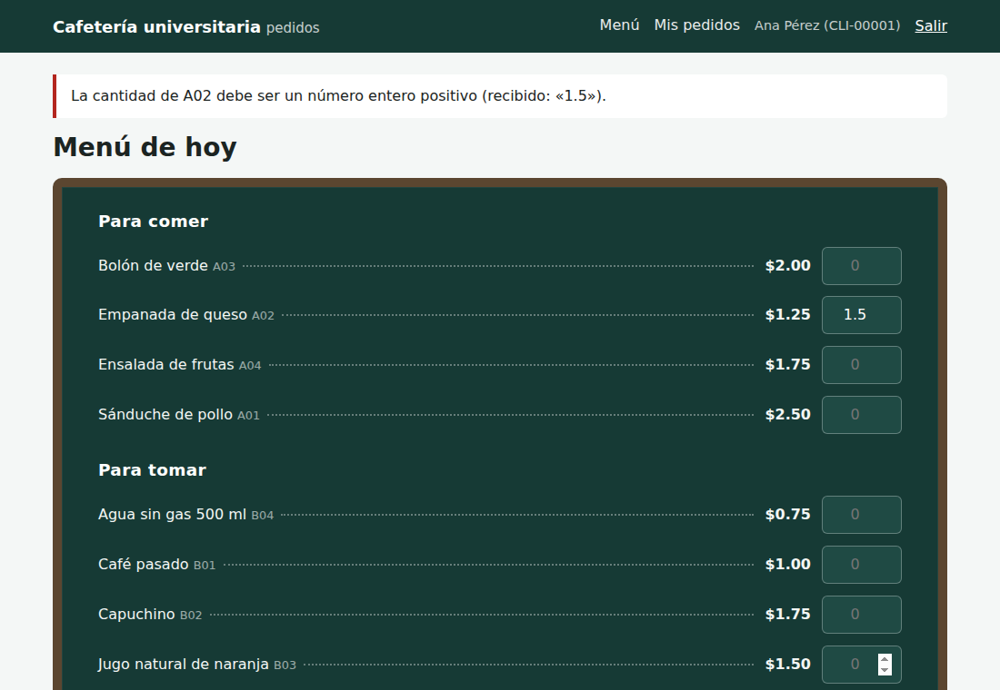

En el celular el menú se adapta al ancho de la pantalla:

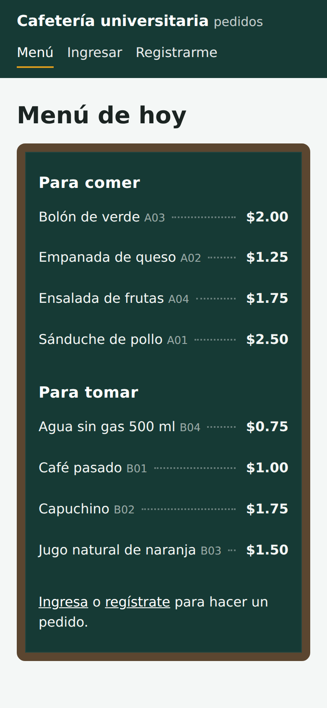

---

## Parte B · Personal de cafetería

### B.1 Ingresar

En la página de inicio pulse **Entrar como personal**, escriba su usuario y clave y pulse **Ingresar**. La barra superior muestra las secciones **Pedidos**, **Entregar** y **Menú**, y su nombre.

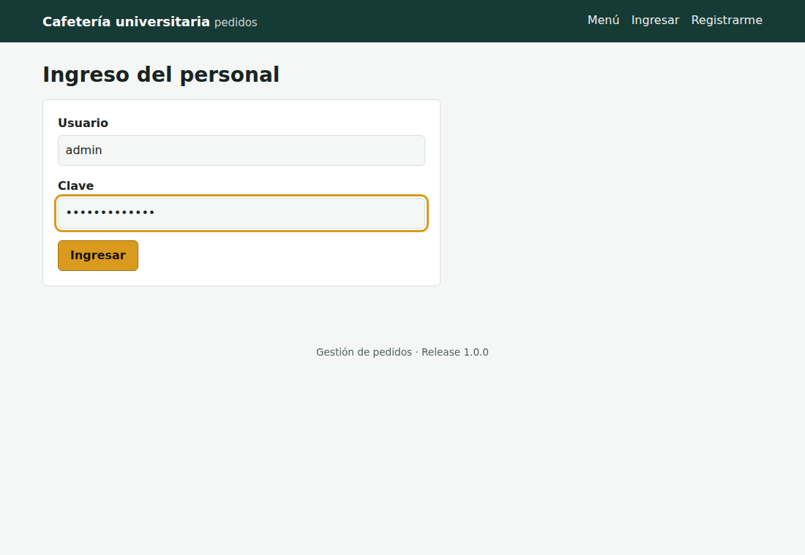

### B.2 Atender los pedidos

La sección **Pedidos** tiene una pestaña por estado con el número de pedidos en cada una. Los pedidos aparecen **en orden de llegada** (el primero de la lista es el más antiguo), con el nombre del cliente, la hora, los productos y el total. La página se actualiza sola cada 45 segundos.

1. En **Pendiente**, pulse **Iniciar preparación** en el pedido que va a preparar.
2. En **En preparación**, cuando termine, pulse **Marcar listo para retirar**.

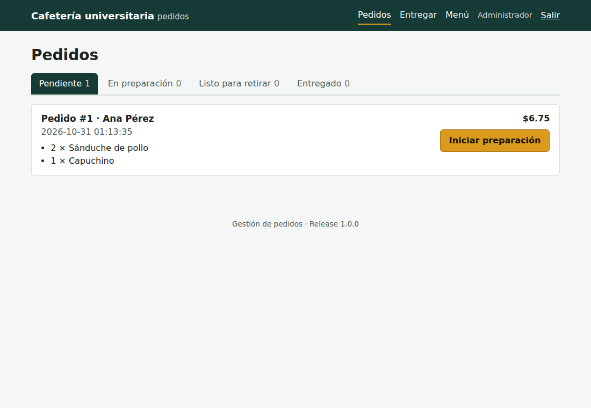

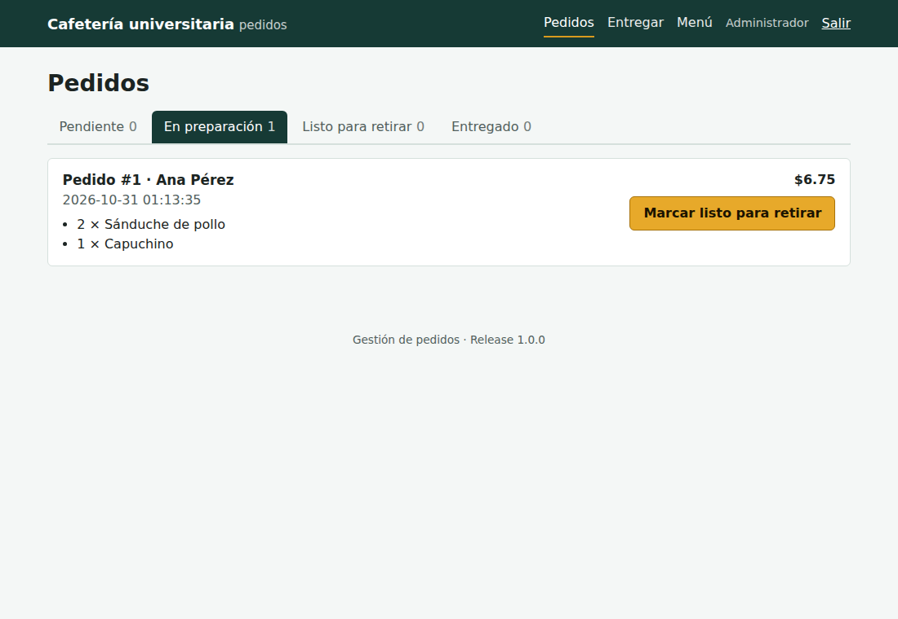

El sistema solo permite avanzar en este orden. Si otro compañero ya cambió el pedido, aparecerá un aviso; recargue la página.

### B.3 Entregar un pedido

Por seguridad, la lista de pedidos **no muestra el código de retiro**: lo trae el cliente.

1. Abra **Entregar**.
2. Pida al cliente su código y escríbalo (no importa si usa mayúsculas o minúsculas, espacios o guiones). Pulse **Buscar pedido**.
3. Compruebe el nombre del cliente y los productos. Si el pedido está **Listo para retirar**, pulse **Registrar entrega**.

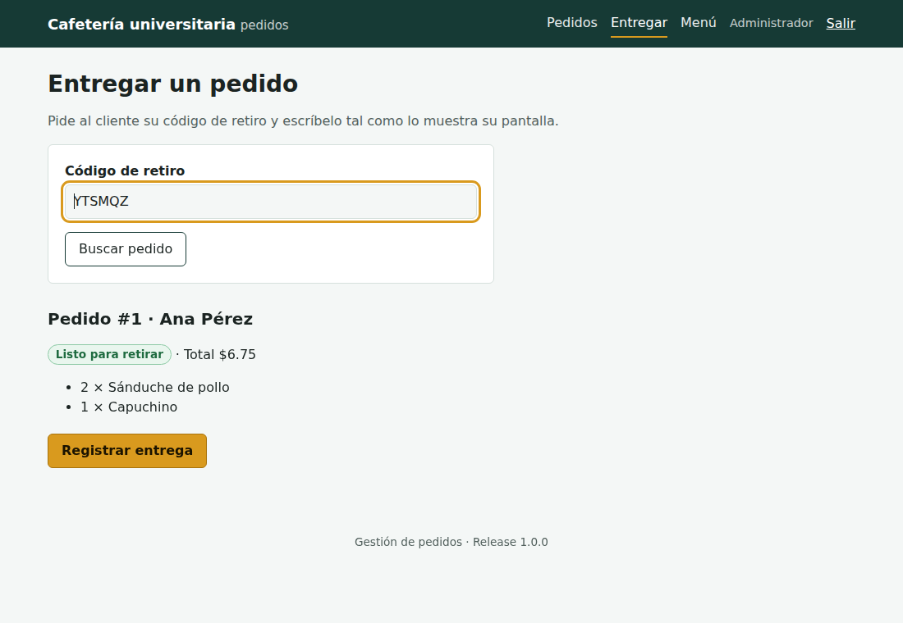

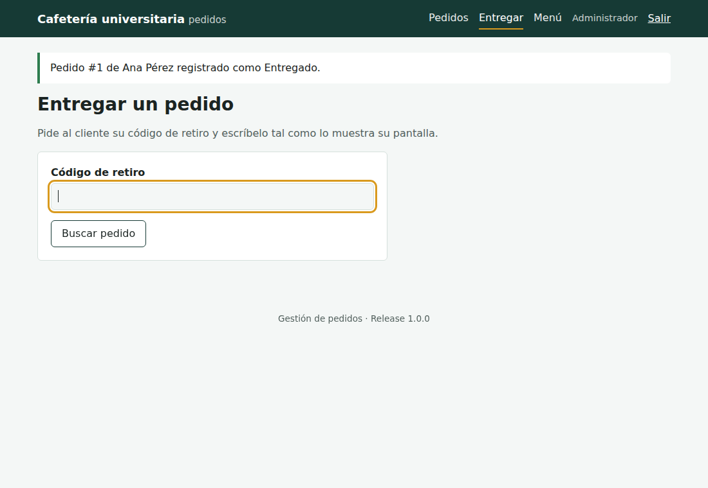

Si el pedido aún no está listo o ya fue entregado, el sistema lo indica y no permite registrar la entrega. Si el código no existe, aparece «No existe ningún pedido con ese código de retiro».

### B.4 Mantener el menú

En **Menú** verá todos los productos, incluidos los no disponibles.

- **Activar / Desactivar**: un clic cambia la disponibilidad. Un producto desactivado deja de aparecer en el menú de los clientes y no puede incluirse en nuevos pedidos.
- **Editar**: cambia nombre, categoría, precio o disponibilidad. El código no se puede cambiar.
- **Agregar producto**: escriba un código (2 a 10 letras, números o guiones, por ejemplo `B05`), nombre, categoría, precio (`0.90` o `0,90`) y marque si está disponible.

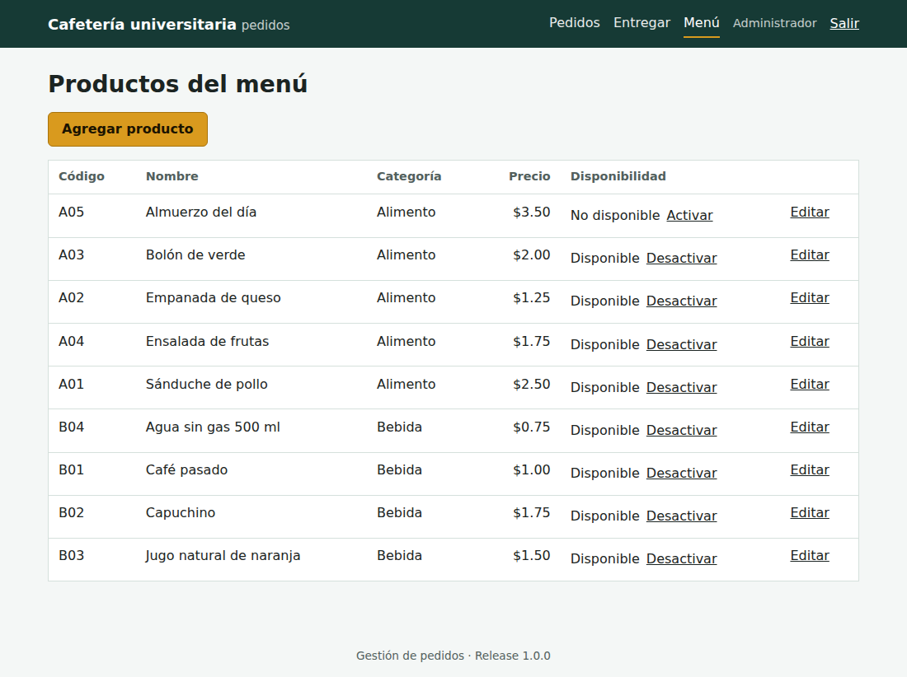

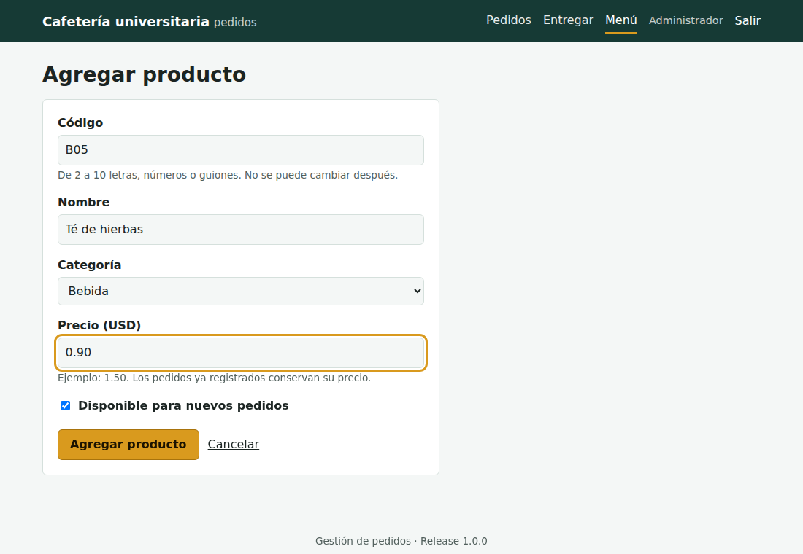

**Cambios de precio:** los pedidos ya confirmados conservan el precio con el que se registraron. Solo los pedidos nuevos usan el precio actualizado. Si un cliente estaba revisando su pedido cuando usted cambió un precio, el sistema le pedirá revisar el nuevo total antes de confirmar.

### B.5 Salir

Pulse **Salir** en la barra superior al terminar el turno, sobre todo en equipos compartidos.

---

## 8.2 Preguntas frecuentes

**¿Se puede pagar en línea?** No. En esta versión el pago se realiza en el mostrador al retirar.

**¿Puedo cancelar un pedido?** No desde el sistema en esta versión. Comuníquelo en el mostrador.

**¿Recibiré una notificación cuando mi pedido esté listo?** No hay notificaciones por correo ni mensajería; consulte «Mis pedidos», que se actualiza automáticamente.

**Perdí mi código de retiro.** Ingrese al sistema y ábralo en «Mis pedidos».

**¿Cómo se crea un nuevo usuario del personal?** Lo hace el responsable técnico con el comando descrito en el *Manual de instalación*, sección 7.7.
